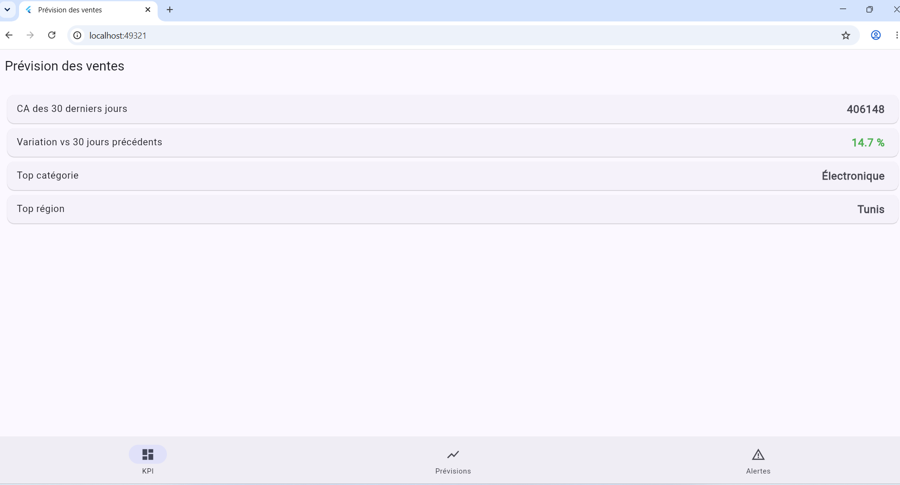
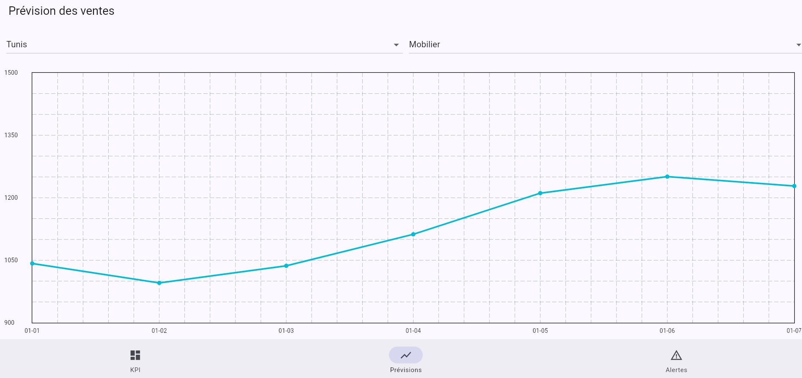
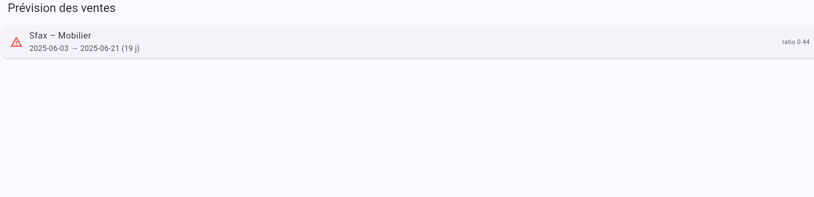

# Plateforme décisionnelle intelligente de prévision des ventes

Prévision du chiffre d'affaires, comparaison de plusieurs algorithmes, détection des baisses de ventes, KPI et recommandations.

**Stack** : Python · Machine Learning (LightGBM) · SQL · FastAPI · Power BI · Flutter/Dart

## Architecture

```
Données (CSV/SQL) → Features → Modèles ML → API FastAPI → App Flutter
                                                      └→ Export CSV → Power BI
```

## Résultats

| Modèle | MAE | MAPE |
|---|---|---|
| Baseline (J-7) | 106.85 | 13.09 % |
| Régression linéaire | 87.41 | 13.75 % |
| Random Forest | 84.12 | 10.47 % |
| XGBoost | 84.60 | 10.22 % |
| **LightGBM** | **83.79** | **10.14 %** |

Entraînement sur 2023-2024, évaluation sur 2025 (découpage temporel).
La détection de baisses repère l'épisode simulé Sfax / Mobilier (juin 2025, ratio 0.44).

## Application mobile







## Lancer le projet

```powershell
python -m venv .venv
.venv\Scripts\activate
pip install -r requirements.txt
python src\generate_data.py
python src\train.py
uvicorn api.main:app --reload
```

Application mobile (dans un second terminal) :

```powershell
cd mobile
flutter run -d chrome
```

## API

- `GET /kpis` : CA des 30 derniers jours, variation, top catégorie et région
- `GET /forecast?region=Tunis&category=Mobilier&days=7` : prévisions
- `GET /alerts` : baisses de ventes détectées

## Données

Données simulées (`src/generate_data.py`), à remplacer par un jeu réel de même structure.